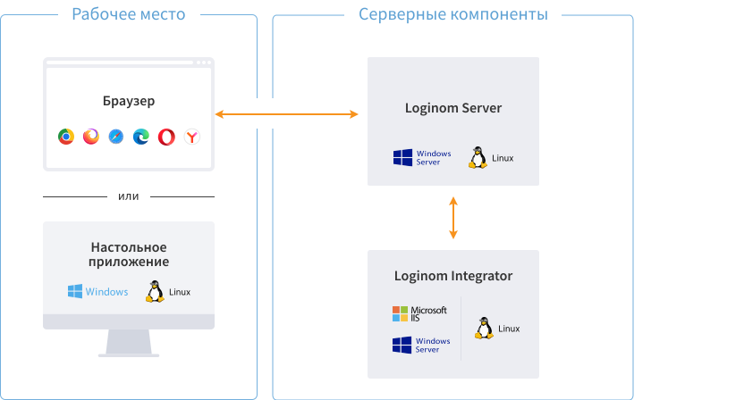

# Loginom — руководство пользователя +

[**Loginom**](https://loginom.ru) — аналитическая платформа, позволяющая в единой среде выполнить все этапы бизнес-анализа от консолидации данных и построения моделей до визуализации и интеграции в бизнес-процесс. 

Работа с Loginom Desktop аналогична Studio, за исключением отсутствующих механизмов интеграции и коллективной работы.

| Функционал компонента | Desktop | Studio |
|:-------------|:------:|:-------:|
| [Проектирование сценариев](./workflow/README.md) | ● | ● |
| [Обработка данных](./processors/README.md) | ● | ● |
| [Визуализация](./visualization/README.md) | ● | ● |
| [Файловое хранилище](./location_user_files.md) | | ● |
| [Планировщик задач](./scheduler/scheduler.md) | | ● |
| [Администрирование](./admin/README.md) | | ● |
| Многопользовательская работа | | ● |
| [Интеграция с внешними источниками](./integration/README.md) | ○1 | ● |

Примечание: 

1 Отсутствуют встроенные механизмы интеграции с бизнес-процессами и SOAP-сервисами (см. [Сравнение редакций](./compare-editions.md)).

 Платформа [Loginom](https://loginom.ru) предлагается в 6-ти редакциях:

* Community Edition
* Personal
* Team
* Standard
* Enterprise
* Cloud

Чтобы выбрать подходящую редакцию, необходимо ориентироваться на кейсы использования и интеграцию в корпоративную информационную среду, а не от доступных алгоритмов обработки или способов визуализации, которые во всех версиях одинаковы.
С более подробным описанием редакций можно ознакомиться в статье «Сравнение редакций».

**Смотри также:**

* [Официальный сайт производителя](https://loginom.ru)
