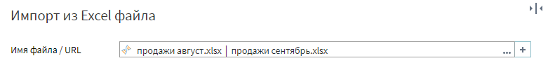
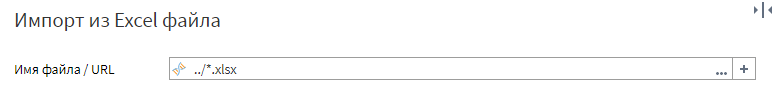
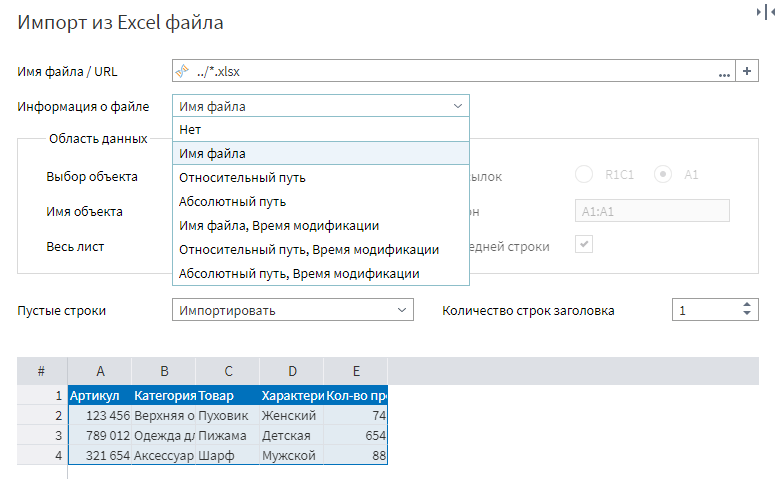
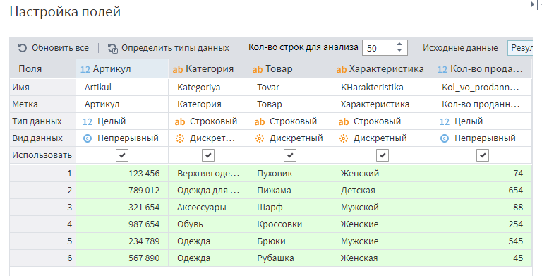
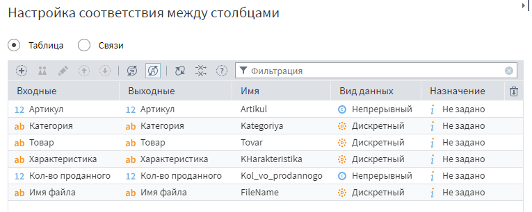
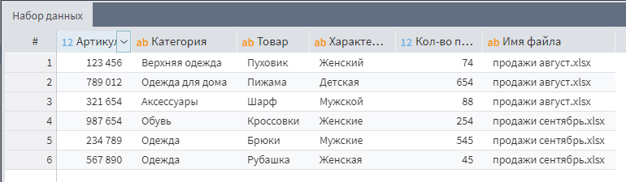

# Примеры импорта из Excel-файла

## Пример 1. Импорт всего листа

При импорте из Excel-файла после задания местонахождения самого документа (Продажи.xlsx) необходимо выбрать, какой именно лист будет импортироваться. Листы можно импортировать по порядковому номеру или по имени листа.

### По номеру (порядковому номеру листа книги)

### По имени (по наименованию листа книги)

Остальные параметры можно оставить по умолчанию:

* **Весь лист** — true (будет импортирован весь лист до самой последней строки).
* **Пустые строки** — *Импортировать* (если лист содержит пустые строки, то они также будут импортированы. Если пустые строки не нужны, либо необходимо импортировать все строки до первой попавшейся пустой строки, то значение параметра необходимо изменить на *Исключить* или на *До первой пустой строки* соответственно).
* **Количество строк заголовка** — 1 (только первая строка в данном случае содержит заголовки столбцов).

На следующем шаге *Настройка полей* можно заменить *Имена* и *Метки* полей, заданные по умолчанию. По умолчанию метки полей задаются транслитерацией имен.

Кроме того, можно указать поля для импорта (убрать/поставить галочку). По умолчанию импортируются все поля.

Полученный результат:

> **Важно**: одновременно импортировать несколько листов нельзя.

## Пример 2. Импорт именованного диапазона

Чтобы импортировать созданный в Excel-е именованный диапазон необходимо в качестве значения параметра **Выбор объекта** указать *Именованный диапазон* и задать значение параметра **Имя объекта** (в данном примере — *Товар*).

Нужно обратить внимание на параметр **До последней строки**, если он — true, то будут взяты все строки до конца листа, даже если в сам диапазон в Excel-файле они не входят.
В текущем примере флаг снят.

Остальные параметры можно оставить по умолчанию.

Полученный результат:

> **Важно**: одновременно импортировать несколько именованных диапазонов нельзя.

## Пример 3. Задание диапазона для импорта через ссылки

Необходимо импортировать лист, который выглядит следующим образом:

Для этого нужно снять флаг у параметра **Весь лист**. После этого станут доступны параметры для выбора диапазона.

В текущем примере в качестве значения параметра **Диапазон** задан диапазон импортируемых ячеек A7:J14. Флаг **До последней строки** снят.

Значение параметра **Диапазон** также можно задать, выделив нужный диапазон данных с помощью мыши.

Полученный результат:

## Пример 4. Импорт из нескольких файлов в одном узле

Для выбора нескольких файлов на первой странице мастера настройки необходимо использовать кнопку . Выбранные файлы будут перечислены в поле *Имя файла/URL* через разделитель — специальный символ `|`. 

Если необходимо импортировать данные из всех файлов, находящихся в одной папке, то *Имя файла/URL* можно задать с помощью маски:

Настройка *Информация о файле* позволяет выбрать дополнительное поле с различными характеристиками файла: именем, путём и временем модификации.

На этом шаге мастера настройки всегда будут отображаться данные только из первого найденного файла. Настройки, заданные на первой странице, являются общими для всех файлов, которые пользователь хочет прочитать.

На следующем шаге отображаются данные из всех доступных файлов. По умолчанию для импорта из Excel файла на этой странице мастера настройки отображается не более 200 строк. 

Третий шаг мастера настроек показывает колонки, которые пользователь выбрал. Здесь можно изменить их порядок отображения в выходном наборе. Активация узла будет читать строки из всех выбранных файлов. 

Полученный набор данных:

