# 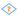 Условие

Компонент используется в точке разветвления сценария в качестве переключателя между вариантами обработки данных. В соответствии с заданными ему условиями выполняется только одна ветвь сценария и блокируется выполнение всех остальных.

Выявление активной ветви происходит по следующему принципу:

1. Ветви проверяются на истинность последовательно по списку сверху вниз, начиная с самой первой.
1. При выявлении ветви со значением «истина» проверка останавливается, ветвь становится активной, а остальные блокируются, даже если ниже по списку остались истинные.
1. Если все ветви примут значение «ложь», то будет активизирована специальная ветвь *Иначе*.

## Порты

Изначально входных и выходных [портов](./../../workflow/ports/README.md) нет, они создаются пользователем в мастере настройки. При первоначальной настройке достаточно добавить входные порты и сохранить настройки компонента. Настройка списка условий при этом не требуется, так как в компонент ещё не передана структура входных данных. Порты могут быть следующих типов:

### Вход

* 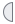 **Входные переменные** — набор переменных.
* 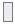 **Входной источник данных** — таблица данных.

### Выход

* 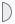 **Выходные переменные** — набор переменных.
* 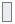 **Выходной набор данных** — таблица данных.

## Мастер настройки

### Шаг 1. Настройка портов узла

Здесь задается наличие необходимых портов. Каждому порту можно задать тип, имя и название, которое будет отображаться при наведении курсора на него.

*  **Добавить** — создать новый порт входа:
  * 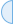 **Переменные** — для переменных.
  * 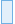 **Таблица** — для таблицы.
  *  **Дерево данных** — для дерева данных.
*  **Переместить вниз**,  **Переместить вверх** — путем смещения выделенного порта определить его положение относительно узла компонента.
*  **Редактировать** — редактировать параметры порта.
*  **Передавать на выход** — для выделенного входного порта будет создан порт выхода в каждой ветви.
*  — удалить порт.
*  — удалить все порты.

### Шаг 2. Настройка списка условий

**Список ветвей условия** — содержит варианты дальнейшего выполнения сценария.

*  **Добавить** — добавить новую ветвь условия.
*  **Переместить вниз**,  **Переместить вверх** — установить приоритет выделенной ветви путем её смещения относительно других ветвей.
*  — удалить ветвь.
*  — удалить все ветви условий.

Ниже располагается таблица — область конфигурации условий для конкретной ветви. Строки в таблице отображаются при выделении ветви в *Списке ветвей условия...* . Каждая строка таблицы представляет собой условие фильтрации либо служебную строку с оператором **ИЛИ**. Если между условиями нет строки **ИЛИ**, то считается, что они объединены через логическое **И**.

Новое условие добавляется нажатием на кнопку  *Добавить условие*. Далее выбирается имя поля, вид агрегации, отношение и значение для сравнения. Для полей строкового типа можно включить опцию «Регистр», в этом случае сравнение будет выполняться с учетом регистра.

На панели инструментов и в контекстном меню доступны следующие команды:

*  **Добавить (Alt+N)** — добавляет новое условие.
* **Добавить оператор ИЛИ (Alt+O)** — добавляет логический оператор ИЛИ.
  * **И** — связываемые условия дадут значение «истина», если они оба истинны.
  * **ИЛИ** — связываемые условия дадут значение «истина», если истинно хотя бы одно из них.
*  **Клонировать (Ctrl+D)** — добавляет новое условие с параметрами, как у выбранного условия.
*  **Переместить вверх (Ctrl+Up)** — поднять условие или логический оператор ИЛИ на одну позицию вверх по списку.
*  **Переместить вниз (Ctrl+Down)** — опустить условие или логический оператор ИЛИ на одну позицию вниз по списку.

Также поля и операторы можно перемещать перетягиванием выше или ниже.

>**Важно:**
>* Условие проверяется на атомарных значениях, например, "A > 1". Таким значением может быть переменная. Если же на вход подана таблица, то поле обозначает не одно значение, а целую колонку. В этом случае данную колонку необходимо свести к одному значению с помощью методов агрегации.
>
>* При написании сложных условий приоритет будет у оператора **И**.
Например, сложное условие вида: "A **ИЛИ** B **И** C **ИЛИ** D **И** E **И** F" будет выполняться следующим образом: "A **ИЛИ** (B **И** C) **ИЛИ** (D **И** E **И** F)".

Таблица настройки условия содержит следующие столбцы:
* **Поле** — содержит список переменных, столбцов таблиц, узлов дерева (для данных в древовидной форме) со всех входных портов узла. Выбранный объект будет использован для сравнения.
* **Агрегация** — содержит список методов [агрегации](./../func/aggregation-functions.md), применимых к полям таблиц. Список недоступен для полей-переменных.  

%spoiler%Агрегация полей и возможные типы данных:%spoiler%

|Вид агрегации|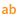|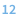|||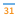||
|:-|:-:|:-:|:-:|:-:|:-:|:-:|
|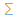 Сумма||**•**|**•**|||**•**|
|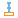 Минимум|**•**|**•**|**•**|**•**|**•**|**•**|
|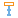 Максимум|**•**|**•**|**•**|**•**|**•**|**•**|
|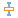 Среднее||**•**|**•**||**•**|**•**|
| Количество пропусков|**•**|**•**|**•**|**•**|**•**|**•**|
|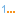 Первый|**•**|**•**|**•**|**•**|**•**|**•**|
|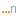 Последний|&nbsp;&nbsp;**•**&nbsp;&nbsp;|&nbsp;&nbsp;**•**&nbsp;&nbsp;|&nbsp;&nbsp;**•**&nbsp;&nbsp;|&nbsp;&nbsp;**•**&nbsp;&nbsp;|&nbsp;&nbsp;**•**&nbsp;&nbsp;|&nbsp;&nbsp;**•**&nbsp;&nbsp;|

%/spoiler%

* **Отношение** — выбор оператора из выпадающего списка: `<`,`<=`,`>`,`>=`,`=`,`<>`.
* **Значение** — значение, с которым будет сравниваться выбранный объект. Значения задаются из выпадающего списка или вручную. Значения добавляются по клавише %kbd Enter %, удаляются — по клавишам %kbd Backspace % или %kbd Delete %.
*  **Удалить все условия** — удалить все условия для выбранной ветви.
*  **Удалить** — удаляет выбранное условие.

> **Примечание**: Если в уже существующем условии требуется изменить *поле*, и тип данных нового поля отличается от типа предыдущего поля, то значения агрегации и отношения корректируются:
> * Если текущее значение недопустимо для нового типа данных, оно заменяется на значение по умолчанию без оповещения пользователя.
> * Если новый тип несовместим со старым:
>   * выполняется попытка конвертации старого значения к новому типу;
>   * при неудаче устанавливается значение по умолчанию для нового типа.

**Режим отладки**  — применяется для проверки корректности данных на выходных портах вне зависимости от условий. Активны будут ветви, указанные в списке *Выполнять ветвь условия*, который включает в себя:

* **Список пользовательских ветвей** — добавленные пользователем ветви, можно выбрать одну из них.
* **Все ветви** — активирует выполнение всех ветвей, в том числе ветвь *Иначе*.
* **Иначе** — активирует выполнение только ветви *Иначе*.

### Шаг 3. Описание узла

**Автоматическая метка** — переключатель режима формирования метки узла.

Если выбран режим *Автоматическая метка* и задана только одна ветвь условия, в качестве метки используется список уникальных меток полей (с указанием меток портов), входящих в условие. При включенном *Режиме отладки* перед этим списком добавляется слово **Отладка**, в противном случае — **Условие**.

*Пользовательская метка* задаётся вручную и не меняется автоматически. В этом режиме можно ввести любое текстовое описание. Рядом с полем ввода отображается значок обновления, который становится активным, если текущая пользовательская метка отличается от метки компонента по умолчанию. Нажатие на значок обновления восстанавливает метку компонента по умолчанию.

На этом шаге также можно задать описание узла на вкладке *Заметка(markdown)*. При задании описания можно использовать синтаксис [markdown](https://ru.wikipedia.org/wiki/Markdown), а результат верстки посмотреть на вкладке *Предпросмотр*. Описание команд панели инструментов приведено в статье [Заметки](./../../workflow/note.md#redaktirovanie-zametki).
