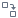

#  Калькулятор (дерево)

Узел **Калькулятор (дерево)** преобразует исходные данные, представленные в виде дерева данных. С помощью *Выражений* в калькуляторе создаются новые расчетные узлы дерева, либо изменяются исходные.

## Порты

### Вход

*  **Входное дерево данных** — порт для подключения входного дерева данных, обязательный.
*  **Входные переменные** — порт принимает входные переменные, необязательный.

### Выход

*  **Выходное дерево данных** — порт, отдающий данные после их преобразования.

## Мастер настройки

Окно настроек содержит области:

 1. [Список выражений](#spisok-vyrazheniy)
 2. [Область кода выражений](#oblast-koda-vyrazheniya)
 3. [Узлы/переменные](#polyaperemennye)
 4. [Список функций](#spisok-funktsiy)

### Список выражений

Область предназначена для ввода *Выражений* — вычисляемых узлов, которыми в результате обработки будет либо дополнено входное дерево данных, либо изменены его исходные узлы. Значение *Выражений* новых и изменяемых узлов будет вычислено с помощью JavaScript кода. В коде JavaScript допускается использование стандартных функций калькулятора. Так же реализованы специфичные функции для работы с иерархической структурой данных.

Новое выражение можно создать при помощи панели инструментов области или контекстного меню. Операции панели инструментов:

*  **Добавить выражение** — добавляет новое выражение с параметрами по умолчанию.
*  **Клонировать выражение** — добавляет новое выражение с типом данных, описанием и формулой, как у текущего выражения.
*  **Редактировать параметры выражения (F2)** — вызывает модальное окно редактирования параметров выражения.
*  **Заменять узел** — включает режим замены исходного значения узла на вычисленное в выражении.
*  **Переместить вверх (Ctrl+Up)** — поднять выражение на одну позицию вверх по списку.
*  **Переместить вниз (Ctrl+Down)** — опустить выражение на одну позицию вниз по списку.

*  **Удалить выражение (Delete)** — удаляет текущее выражение.
*  **Удалить все выражения (Shift+Delete)** — удаляет все имеющиеся выражения.

Контекстное меню в списке выражений дополнительно к вышеперечисленным операциям предлагает следующие:

* **Перейти к выражению (Enter)** — выбор выражения и отображение его кода, область кода становится активной.
* **Перейти к узлу** — выделение соответствующего выражению узла.
*  **Вставить в выражение относительно** — вставляет в область кода ссылку на узел выделенного выражения относительно редактируемого выражения.
* **Вставить в выражение абсолютно** — вставляет в область кода абсолютную ссылку на узел выделенного выражения.

При добавлении и редактировании выражения отображается диалог редактирования параметров. Следующие параметры выражений доступны для изменений:

* **Путь** — из выпадающего списка выбирается абсолютный путь до узла выражения, путь содержит перечень родителей начиная от корневого узла дерева.
* **Имя** — вводится [имя](./../../../data/datasetfieldfeatures.md) узла в выходном дереве данных.
* **Метка** — вводится [метка](./../../../data/datasetfieldfeatures.md) узла в выходном дереве данных.
* **Тип данных** — выбирается [тип данных](./../../../data/datatype.md) узла в выходном дереве данных.
* **Промежуточное** — при установке этого флага выражение может использоваться в расчетах, но не включается в состав узлов выходного дерева данных.
* **Кэшировать** — сохранение однажды вычисленного значения выражения. Целесообразно применять при неоднократном использовании значения выражения последующими обработчиками и визуализаторами во избежание выполнения повторных вычислений.
* **Описание** — поясняющая информация.

> **Важно:** имя должно быть уникальным в пределах непосредственного родителя узла, начинаться с заглавной или строчной латинской буквы или с символа подчеркивания. Для последующих символов имени помимо перечисленных можно использовать цифры.

При первом открытии мастера настройки список *Выражений* содержит один элемент с именем `Expr1` вещественного типа. По умолчанию для нового *Выражения* назначается метка `ВыражениеN` и имя `ExprN`, где `N` — номер, обеспечивающий уникальность.

### Область кода выражения

В области кода задается [JavaScript код](./javascript.md). Ссылки на *Узлы/Переменные* и синтаксические конструкции функций можно вставлять в код *Выражения* ручным вводом, выбрав их двойным кликом мыши в соответствующих областях или перетащив мышкой. Ссылки на созданные *Выражения* задаются в области кода ручным вводом или перетаскиванием мышкой. Также, ссылки на *Выражения* или *Узлы/Переменные* можно добавить в *Область кода* через контекстное меню.

Для выхода из области кода и возврата к предыдущей активной области возможно использовать клавишу %kbd Esc %.

### Узлы/переменные

Область содержит дерево исходных и созданных с помощью выражений *Узлов*, а также список *Переменных*, передаваемых на вход обработчика. По умолчанию в области выводится дерево узлов. Переключение на отображение *Узлов* или *Переменных* осуществляется с помощью одноименных кнопок. Перечень и параметры исходных узлов/переменных определяются при настройке входных портов обработчика.

Контекстное меню области узлов предлагает следующие операции:

*  **Добавить дочерний узел** — вызывает модальное окно добавления дочернего по отношению к выбранному узлу *Выражения* (доступно для [узлов-контейнеров](./../README.md)).
*  **Добавить соседний узел** — вызывает модальное окно добавления соседнего по отношению к выбранному узлу *Выражения*.
* **Добавить контейнер** — добавляет в дерево узел, способный иметь дочерние узлы.
*  **Заменить вычисляемым выражением** — для выбранного узла добавляет новое *Выражение* и включает режим замены исходного значения узла на вычисленное в *Выражении*.
*  **Вставить в выражение относительно** — вставляет в область кода ссылку на выбранный узел относительно редактируемого *Выражения*.
* **Вставить в выражение абсолютно** — вставляет в область кода абсолютную ссылку на выбранный узел.
* **Перейти к выражению** — выделяет выражение, создавшее выбранный узел, и делает активным область кода (доступно для вычисляемых *Выражением* узлов).
*  **Редактировать параметры (F2)** — вызывает модальное окно редактирования параметров выражения, создавшего выбранный узел (доступно для вычисляемых *Выражением* узлов).
*  **Удалить выражение** — удаляет текущий узел и его выражение (доступно для вычисляемых *Выражением* узлов).

При применении к узлу (или его выражению) опции *Заменить вычисляемым выражением*, метка узла становится ссылкой, нажатие на которую выбирает *Выражение* этого *Узла*, и делает активной *Область кода* (действие аналогично выполнению пункта контекстного меню *Перейти к выражению*).

Контекстное меню области переменных предлагает операцию:

*  **Вставить в текст выражения** — вставляет в область кода ссылку на переменную.

Двойной клик мыши по позиции списков вводит относительную ссылку на узел или ссылку на переменную в область кода выражения. То же самое можно сделать при помощи Drag-and-drop. Те же действия с зажатым %kbd Ctrl % вставляют абсолютную ссылку на узел.

> **Примечание:** автоматически созданные вышеописанным способом ссылки на узлы, *входящие в массив*, могут быть *неполными*, поскольку в них не будет указан индекс элемента массива, на который необходимо сослаться в выражении. Индекс элемента массива указывается в квадратных скобках `[]`. Пример: в выражении `Parent().Order[].Address` для ссылки на второй элемент массива *Order[]* необходимо модифицировать ссылку следующим образом — `Parent().Order[1].Address`. Индексация элементов в массиве начинается с 0. Для определения индекса текущего элемента массива может использоваться функция `ItemIndex()` (см. примеры в разделе [JavaScript](./javascript.md)).

Если у *Узла* и *Переменной* совпадают имена, то в коде выражения по умолчанию будет использоваться имя *Узла*. В таком случае к *Переменной* можно обращаться только через префикс `this.Var.`.

Подробнее о представлении дерева и его узлов в *Выражениях* см. раздел JavaScript.

### Список функций

Поддерживаются все функции [Калькулятора (переменные)](./../../variables/variables-calc.md). 

Наименование, входные аргументы и описание [доступных для использования функций](./../../func/calc-func/README.md).

[Специфические для Калькулятора (дерево) функции](./../../func/calc-func/data-tree.md), предназначенные для работы с деревом данных. 

Пример использования функции калькулятора см. в разделе JavaScript.

Возможна фильтрация по категории и названию функции.

Двойной клик мыши по позиции выбранной функции вставляет ее в область кода выражения. То же самое можно сделать при помощи Drag-and-drop.
