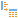

#  Дерево в таблицу

Компонент преобразует данные, представленные в иерархической древовидной форме, в таблицу. Отмеченные узлы будут выведены в колонки выходного набора данных.

## Порты
### Вход

 **Входное дерево** — набор данных в иерархической древовидной форме.

### Выход

 **Выходной набор данных** — таблица данных.

## Мастер настройки

### Настройка входного набора

Данные во входном порте узла представлены в виде входного и выходного наборов.

В списке *Входное дерево* отображаются поля принятого портом набора данных, которые следует сопоставить с полями набора, подаваемого портом на обработку — *Выходное дерево* (подробнее см. [Порты](./../../workflow/ports/README.md)).

Структуру набора, подаваемого на обработку, можно задать вручную, или загрузить из файла `.xsd` или `.json`.

При ручном формировании структуры набора, который впоследствии будет подан на обработку, используются команды панели инструментов или контекстного меню (подробнее см. [Настройка порта «Дерево»](./../../workflow/ports/mapping-trees.md#nastroyka-porta-«derevo»)).

Структуру *Выходного* дерева можно загрузить [из файла формата XSD](./../../workflow/ports/mapping-trees.md#zagruzka-struktury-uzlov-iz-xsd-skhemy), а так же [из файла или строки формата JSON](./../../workflow/ports/mapping-trees.md#zagruzka-struktury-uzlov-iz-json-struktury).

Для сопоставления узлов *Входного и Выходного дерева* необходимо задать между ними связи (подробнее см. [Сопоставление узлов дерева](./../../workflow/ports/mapping-trees.md#sopostavlenie-uzlov-dereva)).

### Выбор узлов дерева

Мастер настройки узла представляет собой отображение дерева (дерево, поданное на выход входного порта) с возможностью выбора некоторых или всех узлов. Отмеченные узлы будут выведены в колонки выходного набора данных.

Доступные действия представлены в виде кнопок на панели инструментов и в контекстном меню:

*  **Выбрать все** — помечает все узлы.
*  **Снять выделение со всех** — снимает выделение со всех узлов.
*  **Инвертировать выделение** — меняет выбранные узлы на невыбранные и наоборот.

Пометить выделенный узел можно, нажав клавишу *Enter*, повторное нажатие *Enter* снимает выделение.

Логика выбора узлов:

* При выборе узла выбираются также и его родители, вплоть до корня.
* При снятии выделения с ветки выделение снимается и со всех потомков.
* Глобальный индекс узла — узел отсутствует в древовидной структуре данных, однако он появляется в отображении дерева и указывает на индекс, используемый в узле-массиве. Его можно выбрать, при этом также выбирается и узел массива.
Узел получает индекс -1, который учитывается при сортировке.
При выборе узла для него формируется колонка с именем узла массива с добавлением  "_global_index" и меткой узла массива с добавлением "|Глобальный индекс".

> **Важно:** Компонент будет выдавать ошибку при выходе со страницы настройки или при выполнении, если у него нет ни одного выбранного узла.

 **Составные имена полей** — если флаг установлен, используется составное имя узла массива: в именах полей будет отражена иерархия относительно корневого элемента.

 **Дублировать значения родительских узлов** — если в структуре имеется родительский узел и последовательность потомков, значение родительского узла будет продублировано для каждой строки, образованной из последовательности потомков.

 **Составные метки полей** — при установленном флаге используется составная метка узла массива: в метках полей будет отражена иерархия относительно корневого элемента.

**Разделитель составных меток** — символ, разделяющий компоненты составных меток, его можно выбрать из предложенного списка или ввести собственное значение.

### Описание узла

* **Автоматическая метка** — переключатель режима формирования метки узла. Если выбран режим *Автоматическая метка*, то она формируется по правилу: `Список меток выбранных узлов дерева`. Если выбран режим *Пользовательская метка* — метка задается пользователем.

На этом шаге также можно задать описание узла на вкладке *Комментарий (markdown)*. При задании описания можно использовать синтаксис `markdown`, а результат верстки посмотреть на вкладке *Предпросмотр*. Описание команд панели инструментов приведено в статье [Заметки](./../../workflow/note.md).