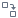

#  Калькулятор

Добавляет новые вычисляемые поля или изменяет значения существующих по заданной формуле из значений переменных, других полей и [функций](./../../func/calc-func/README.md) или используя [JavaScript](./javascript.md) код.

### Вход

*  Входной источник данных (таблица данных).
*  Входные переменные (переменные), необязательный.

### Выход

*  Выходной набор данных (таблица данных).

## Мастер настройки

Окно настроек содержит области:

 1. [Список выражений](#spisok-vyrazheniy)
 2. [Область кода выражений](#oblast-koda-vyrazheniya)
 3. [Поля/переменные](#polyaperemennye)
 4. [Список функций](#spisok-funktsiy)

### Список выражений

Область предназначена для ввода *Выражений* — вычисляемых значений, которыми в результате обработки заполняются новые поля набора данных или изменяются исходные. Значение *Выражения* в каждой строке набора данных будет вычислено по [формуле](./expression.md) или [JavaScript коду](./javascript.md).

Новое *Выражение* можно создать при помощи панели инструментов области или контекстного меню. Операции панели инструментов:

* | **Синтаксис** (выпадающий список)— задание [синтаксиса расчета выражений](#sintaksis-kalkulyatora) Калькулятора.
*  **Добавить выражение** — добавляет новое *Выражение* с параметрами по умолчанию.
*  **Клонировать выражение** — добавляет новое *Выражение* с типом данных, описанием и формулой, как у текущего *Выражения*.
*  **Редактировать параметры выражения... (F2)** — задание параметров *Выражения*.
*  **Заменять поле** — включает режим замены исходного значения поля на вычисленное в *Выражении*.
*  **Переместить вверх (Ctrl+Up)** — поднять *Выражение* на одну позицию вверх по списку.
*  **Переместить вниз (Ctrl+Down)** — опустить *Выражение* на одну позицию вниз по списку.
*  **Удалить выражение (Delete)** — удаляет текущее *Выражение*.
*  **Удалить все выражения... (Shift+Delete)** — удаляет все имеющиеся *Выражения*.

Контекстное меню в списке *Выражений* дополнительно к вышеперечисленным операциям предлагает следующие:

* **Перейти к выражению** — выбор *Выражения* и отображение его кода.
*  **Вставить относительное имя в выражение** — вставляет *Имя выражения* в область кода.

При добавлении и редактировании *Выражения* отображается диалог редактирования параметров. Следующие параметры *Выражений* доступны для изменений:

* **Имя** — вводится [имя поля](./../../../data/datasetfieldfeatures.md), присваиваемое столбцу в выходном наборе данных.
* **Метка** — вводится [метка поля](./../../../data/datasetfieldfeatures.md), присваиваемая столбцу в выходном наборе данных.
* **Тип данных** — выбирается [тип данных](./../../../data/datatype.md) поля в выходном наборе данных.
* **Промежуточное** — при установке этого флага выражение может использоваться в расчетах, но не включается в список полей выходного набора данных.
* **Кэшировать** — сохранение однажды вычисленного значения *Выражения*. Целесообразно применять при неоднократном использовании значений *Выражения* последующими узлами и визуализаторами во избежание выполнения повторных вычислений.
* **Описание** — поясняющая информация.

> **Важно:** имя должно быть уникальным, начинаться с заглавной или строчной латинской буквы или с символа подчеркивания. Для последующих символов имени помимо перечисленных можно использовать цифры.

При первом открытии мастера настройки список *Выражений* содержит один элемент с именем `Expr1` вещественного типа. По умолчанию для нового *Выражения* назначается метка `ВыражениеN` и имя `ExprN`, где `N` — номер, обеспечивающий уникальность.

### Область кода выражения

В области кода в зависимости от выбранного синтаксиса калькулятора задается [формула расчета *Выражения*](./expression.md) или [JavaScript код](./javascript.md). Ссылки на входящие поля/переменные и синтаксические конструкции функций можно вставлять в код выражения ручным вводом, выбрав их двойным кликом мыши в соответствующих областях или перетащив мышкой. Ссылки на созданные в Калькуляторе выражения задаются в области кода ручным вводом или перетаскиванием мышкой. Так же, ссылки на *Выражения* или *Поля/Переменные* можно добавить в *Область кода* через контекстное меню.

> **Важно:** из текущего *Выражения* можно ссылаться только на *Выражения* выше по списку.

Если у *Поля* и *Выражения* совпадают имена, то в коде *Выражения* по умолчанию будет использоваться *Поле*. В таком случае к *Выражению* можно обращаться только через префикс `Expr.`/`this.Expr.` ( `Expr.` используется для синтаксиса [Выражение](./expression.md), `this.Expr.` — для синтаксиса [Javascript](./javascript.md)).

Для выхода из области кода и возврата к предыдущей активной области возможно использовать клавишу [Esc].

### Поля/переменные

Область содержит список *Полей* и *Переменных*, передаваемых на вход узла. Перечень и параметры полей/переменных определяются при настройке входных портов узла.

Контекстное меню области *Поля* предлагает следующие операции:

*  **Заменить вычисляемым выражением** — для выбранного *Поля* добавлет новое *Выражение* и включает режим замены исходного значения *Поля* на вычисленное в *Выражении*.
*  **Вставить в текст выражения** — вставляет *Имя Поля* в область кода.
* **Перейти к выражению** — становится активной, если к *Полю* был применен пункт *Заменить вычисляемым выражением*. Выбирает *Выражение*, заменяющее данное *Поле*, и делает активной *Область кода*.

> **Важно:** при применении к *Полю* пункта **Заменить вычисляемым выражением**, метка поля становится ссылкой, нажатие на которую выбирает *Выражение*, заменяющее данное *Поле*, и делает активной *Область кода* (действие аналогично выполнению пункта контекстного меню **Перейти к выражению**).

Контекстное меню области *Переменные* предлагает следующие операции:
*  **Вставить в текст выражения** — вставляет *Имя Переменной* в область кода.

Двойной клик мыши по позиции списка вводит имя поля/переменной в область кода выражения. То же самое можно сделать при помощи Drag-and-drop.

Если у *Поля/Выражения* и *Переменной* совпадают имена, то в коде выражения по умолчанию будет использоваться *Поле/Выражение*. В таком случае к *Переменной* можно обращаться только через префикс `Var.`/`this.Var.` ( `Var.` используется для синтаксиса [Выражение](./expression.md), `this.Var.` — для синтаксиса [Javascript](./javascript.md) ).

> **Примечание:** при добавлении *Переменной* с именем существующего *Поля* в *Калькуляторе*, к имени *Переменной* добавляется префикс `Var.`.

### Список функций

Наименование, входные аргументы и описание [доступных для использования функций](./../../func/calc-func/README.md).

Возможна фильтрация по категории и названию функции.

Двойной клик мыши по позиции выбранной функции вставляет ее синтаксис в область кода *Выражения*. То же самое можно сделать при помощи Drag-and-drop.

Ссылки на поля/переменные и синтаксические конструкции функций можно вставлять в код *Выражения*, выбрав их двойным кликом мыши в соответствующих областях или перетащив мышкой.

## Синтаксис калькулятора

В Калькуляторе существует два способа расчета выражений:

*  [Выражение](./expression.md)
*  [JavaScript](./javascript.md)

Для выбора синтаксиса необходимо в меню списка *Выражений* выбрать *JavaScript* или *Выражение* (см. рисунок 1).

> **Примечание:** 
> * режим работы Калькулятора *Выражение* или *JavaScript* выбирается для всех полей, т.е. нельзя установить для одного поля синтаксис *Выражение*, а для другого *JavaScript*.
>
> * в узле *Калькулятор* все числовые значения представляются в виде вещественного формата двойной точности, соответствующего стандарту IEEE 754-2008. При этом для целых чисел за пределами диапазона [-(253 - 1), 253 - 1] происходит потеря точности. Пример: результатом выражения Val("6 405 472 121 753 949 359") с [типом данных](./../../../data/datatype.md) *Целый* будет значение  6 405 472 121 753 949 184.
