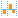

#  Визуализаторы

Визуализатор представляет собой инструмент, позволяющий пользователю выбрать удобный вариант отображения данных.

Визуализаторы:

*  [Диаграмма](./chart/README.md) — графическое представление данных.
*  [Качество данных](./data-quality/README.md) — производит комплексную оценку качества данных для каждого поля.
*  [Куб](./cube/README.md) — многомерное представление данных.
*  [Статистика](./statistics/README.md) — статистические показатели полей набора данных.
*  [Таблица](./table/README.md) — табличное представление данных.
*  [Дубликаты и противоречия](./duplicates/README.md) - предназначен для просмотра дублирующих, противоречивых записей исходного набора данных.
*  [Конечные классы](./coarse-classes/README.md) — результаты процедуры оптимального квантования в виде начальных и конечных классов, а также WoE-диаграммы и значений [информационных индексов IV](https://wiki.loginom.ru/articles/information-value.html).
*  [Профили кластеров](./cluster-profiles/README.md) — различные статистические показатели кластеров, структура кластеров и их сравнение между собой.
*  [Отчет по линейной регрессии](./linear-regression/README.md) и  [Отчет по регрессии](./regression/README.md) — статистические параметры и результаты статистических тестов для анализа регрессионных моделей.
*  [Качество бинарной классификации](./binary-classification/README.md) — формирует наборы серий данных для построения диаграмм, определяются оптимальные пороги отсечения и вычисляются оценки классификации. Для получения точек серий строятся гистограммы распределения событий и не-событий в выборках.

Также есть специальные визуализаторы, недоступные в мастере *Настройки визуализаторов* и с ограниченным функционалом. Они подходят для предварительного изучения или контроля данных:

*  [Быстрый просмотр](./preview/quick-view.md) — доступно на активном выходном порту;
*  [Предпросмотр](./preview/preview.md) — доступно в определенных мастерах, например: *Калькулятор*, *Импорт из базы данных*, *JavaScript*.

## Работа с визуализаторами

Для добавления визуализатора к узлу сценария требуется нажать кнопку  *Настройка визуализаторов*. В открывшемся окне слева находится дерево доступных визуализаторов, справа расположен список выходных портов узла, данные которых можно визуализировать.

Для добавления визуализатора, надо выбрать в дереве необходимый визуализатор и нажать кнопку *Добавить визуализатор* у нужного выходного порта. Также это можно сделать, перетащив мышкой необходимый визуализатор в область кнопки *Добавить визуализатор* у нужного выходного порта.

Панель инструментов Страницы «Визуализаторы» содержит следующие команды:

*  **Переименовать (F2)** — изменить имя выбранного визуализатора.
*  **Вырезать (CTRL+X)** — пометить выбранный визуализатор для вырезания.
*  **Копировать (Ctrl+C)** — пометить выбранный визуализатор для копирования.
*  **Вставить (Ctrl+V)** — вставить визуализатор, помеченный для копирования или для вырезания.
*  **Клонировать** — добавить новый визуализатор, идентичный выбранному.
*  **Удалить (Delete)** — удалить выбранный визуализатор.
*  **Удалить все...** — удалить все имеющиеся визуализаторы.
* &nbsp;&nbsp;&nbsp;&nbsp; **Добавить в отчеты** — добавить отчет для выбранного визуализатора.

Операции *Копировать* и *Вырезать* можно выполнять как с одним визуализатором, так и с несколькими визуализаторами.

Для визуализатора или группы визуализаторов можно создать копии на текущем узле или перенести их на другой узел. Если у узла, на который выполняется перенос визуализатора, несколько выходных портов, то у команды *Вставить* появляется раскрывающийся список, через который необходимо выбрать нужный порт.

Для удаления визуализатора необходимо нажать кнопку  в правом верхнем углу визуализатора.

> **Важно**: Данные не каждого порта возможно отобразить выбранным визуализатором. Если какой-либо визуализатор не поддерживается портом, то он добавлен не будет.

Каждый визуализатор может быть добавлен в [*Отчеты*](./../report/README.md). Для этого необходимо выбрать нужный визуализатор и нажать кнопку *Добавить в отчеты*. При добавлении визуализатора в *Отчеты* можно выбрать группу, в которую нужно его добавить, создать новую группу для визуализатора или поместить его в *Отчеты* без группы.
