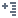

#  Добавить факт

В данном окне для факта необходимо выбрать [вариант агрегации](./README.md#fakty) и [способ отображения](./README.md#fakty).

## Операции

*  **Переместить вверх** — переместить вариант агрегации/способ отображения на позицию вверх;
*  **Переместить вниз** — переместить вариант агрегации/способ отображения на позицию вниз;
*  **Свернуть дерево** — свернуть дерево вариантов агрегации и способов отображения;
*  **Развернуть дерево** — развернуть дерево вариантов агрегации и способов отображения;
*  **Выбрать все** — выбрать все варианта агрегации со всеми способами отображения;
*  **Отменить выбор всех** — убрать выбор всех вариантов агрегации со всеми способами отображения.
