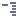
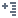
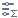

# Панель инструментов Куба

Содержит следующие управляющие элементы:

*  **Поля** — показать/скрыть список полей набора данных.
*  **Детализация** — показать/скрыть [детализацию](./details.md).
*  **Способ детализации** — переключить варианты отображения детализации:
  *  **Таблица**.
  *  **Форма**.
  *  **Статистика**.
*  **Создать диаграмму** — создать диаграмму с заголовком по умолчанию `Диаграмма %номер%` (становится неактивной после создания третьей диаграммы).  
*  **Диаграмма** — показать/скрыть [диаграмму(-ы)](./chart.md) (кнопка неактивна если не создана ни одна диаграмма).
*  **Свернуть** — свернуть иерархию измерений куба:
  * **Свернуть все**.
  * **Свернуть колонки**.
  * **Свернуть строки**.
*  **Развернуть** — развернуть иерархию измерений куба:
  * **Развернуть все**.
  * **Развернуть колонки**.
  * **Развернуть строки**.
*  **Итоги**  — показать/скрыть итоговые заголовки:
  *  **Все**.
  *  **В колонках**.
  *  **В строках**.
  *  **Нигде**.
*  **Выравнивание ширины колонок**:
  *  **Равная ширина фактов**.
  *  **Равная ширина колонок**.
*  **Транспонировать** — переместить измерения из строк в столбцы и наоборот.
* 
  **Настроить измерения** — открыть окно для [настройки измерений](./configure-axis.md).
*   **Настроить факты…** — открыть окно [настройки фактов](./configure-measures.md).
*  **Добавить вычисляемый факт…** — открыть окно для добавления нового [вычисляемого факта](./calculated-measure.md) в куб[^1].
*  **Фильтровать факты…** — открыть окно для  [фильтрования фактов](./filter-measures.md).
*  **Форматирование…** — открыть окно для [форматирования](./format-measures.md) фактов и заголовков измерений.
*  **XLS** - экспорт в файл:
  * **экспорт в XLS (html)** — сохранить текущее представление в формате Excel.
  * **экспорт в HTML** — сохранить текущее представление в формате HTML.
*  **Приостановить автовычисление** — отключить обновление заголовков и данных.

[^1]: добавленный ранее вычисляемый факт можно редактировать или удалить в окне *Настройки фактов*.
  
Указанные операции доступны также через контекстное меню, которое можно вызвать кликом правой клавиши мыши в любом месте Области построения. Помимо кнопок Панели инструментов, в контекстном меню присутствуют пункты:
*  **Скрыть единственный факт** — позволяет скрыть заголовки фактов, если активен единственный факт.
* **Выбрать и подсветить** — подсвечивает соответствующую точку данных во всех развёрнутых диаграммах, если она есть и не принадлежит скрытой серии.
* **Повторять заголовки** — повторяет сводные заголовки в кросс-таблице куба. Сводный — заголовок любой заголовок, размах которого в таблице более 1 ячейки. Данные повторяются следующим образом:
  * Заголовки фактов и агрегаций — разбиваются на одинаковые.
  * Развёрнутые заголовки измерений — разбиваются на одинаковые, но кнопка  остается только у первого заголовка.
  * Свёрнутые заголовки измерений — разбиваются на исходный заголовок и последовательность заголовков «Итого: » для каждого уровня ниже.

%spoiler%**Горячие клавиши:**%spoiler%

* %kbd Up % / %kbd Down % / %kbd Left % / %kbd Right % — перейти на одну ячейку вверх/вниз/влево/вправо.
* %kbd PageUp % / %kbd PageDown % — перейти на экран вверх/вниз.
* %kbd Alt % + %kbd PageUp % / %kbd PageDown % — перейти на экран вправо/влево.
* %kbd Home % / %kbd End % — перейти до конца вправо/влево.
* %kbd Alt % + %kbd Home % / %kbd End % — перейти до конца вверх/вниз.
* %kbd + % / %kbd - % — раскрыть/свернуть заголовки в строках.
* %kbd Alt % + %kbd + % / %kbd - % — раскрыть/свернуть заголовки в столбцах.
* %kbd Alt % + %kbd Up % / %kbd Down % / %kbd Left % / %kbd Right % — перейти к выделенной ячейке.
* %kbd Shift scroll % — прокрутка колесом мыши по горизонтали.
* %kbd Alt Click % — если клик был выполнен на непустой ячейке данных, во всех развернутых диаграммах выделится соответствующая точка данных диаграммы Куба. Если клик был выполнен на точке данных в диаграмме Куба, то выделится соответствующая ячейка кросс-таблицы.

%/spoiler%
