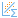
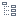
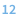

#  Отчет по регрессии

Визуализатор *Отчет по регрессии* компонента [*Линейная регрессия*](./../../processors/datamining/linear-regression/README.md) отображает параметры и результаты статистических тестов для анализа регрессионных моделей.

Данный визуализатор состоит из трех областей:

* [Информация о модели](#informatsiya-o-modeli)
* [Коэффициенты регрессии](#koeffitsienty-regressii)
* [Шаги построения](#shagi-postroeniya)

## Интерфейс

### Операции

#### Область Информация о модели

*  **Информация о модели** — отображение/скрытие [информации о модели](#informatsiya-o-modeli).

#### Область Коэффициенты регрессии

*  **Таблица** — переключение отображения [коэффициентов регрессии](#koeffitsienty-regressii) в вид *Таблица*.
*  **Дерево** — переключение отображения коэффициентов регрессии в вид *Дерево*.
*  **Нулевые значения** — отображение/скрытие нулевых значений.

#### Область Шаги построения

*  **Шаги построения** — отображение/скрытие [шагов построения](#shagi-postroeniya) модели.

### Области визуализатора

#### Информация о модели

* Модель (выпадающий список) - позволяет выбрать одну из моделей, созданных пошаговым алгоритмом в процессе отбора факторов.

Описание показателей модели представлено в таблице:

|Показатель|Описание|
|:------------------------|:-----------------------------------------------|
|  Константа| Информация о том содержит модель константу или нет |
| Логарифм [функции правдоподобия](https://wiki.loginom.ru/articles/plausibility-function.html) | Показывает степень соответствия модели набору данных, на котором она обучается |
|  [Коэффициент детерминации](https://wiki.loginom.ru/articles/coefficient-of-determination.html) | Доля дисперсии зависимой переменной, объяснённая регрессионной моделью (изменяется от 0 до 1) |
|  [Коэффициент детерминации (скорр.)](https://wiki.loginom.ru/articles/coefficient-determ-adj.html) | Отличается от нескорректированного коэффициента детерминации тем, что накладывает штраф за дополнительно вводимые в модель переменные (изменяется от 0 до 1) |
|  Стандартное отклонение | Мера отклонения примеров от предсказанных моделью значений |
|  Число степеней свободы ошибки | Разность между размером выборки и числом оцениваемых параметров модели |
|  [Число степеней свободы модели](https://wiki.loginom.ru/articles/degrees-of-freedom.html)| Число независимо варьируемых [переменных](https://wiki.loginom.ru/articles/attribute.html) модели |
|  [F-статистика](https://wiki.loginom.ru/articles/f-test.html) | Статистика F-теста для оценки значимости модели |
|  [Р-значение модели](https://wiki.loginom.ru/articles/p-value.html)| Оценка [значимости](https://wiki.loginom.ru/articles/significance-regr.html) модели. Чем меньше P-значение, тем меньше вероятность нулевой гипотезы о том, что нет статистически значимой связи между зависимой и независимыми переменными. Вычисляется по F-статистике. |
|  [Критерий Акаике](https://wiki.loginom.ru/articles/aic.html) | Критерий используется для сравнения моделей с разным числом параметров, когда требуется выбрать наилучший набор объясняющих переменных |
|  [Критерий Акаике (скорр.)](https://wiki.loginom.ru/articles/aicc.html) | Модифицированный критерий Акаике, применяемый для выборок малого размера, когда отношение числа содержащихся в ней примеров к числу параметров модели меньше 40 |
|  [Критерий Байеса](https://wiki.loginom.ru/articles/bic.html) | Критерий основан на использовании функции правдоподобия и тесно связан с информационным критерием Акаике |
|  [Критерий Ханнана-Куинна](https://wiki.loginom.ru/articles/hq.html) | Критерий основан на использовании функции правдоподобия и является альтернативой критериям Акаике и Байеса |

#### Коэффициенты регрессии

Описание коэффициентов представлено в таблице:

|Коэффициент|Описание|
|:--------------------|:----------|
| Коэффициент | Оценка значений коэффициентов при независимых переменных |
| Стандартная ошибка | Стандартная ошибка оценки коэффициента |
| [Т-статистика](https://wiki.loginom.ru/articles/students-distribution.html) | Статистика Т-критерия Стьюдента для оценки значимости переменной |
| Р-значение | Оценка значимости переменной. Чем меньше Р-значение, тем меньше вероятность нулевой гипотезы о том, что коэффициент при независимой переменной равен 0. Вычисляется по Т-статистике. |
| Нижняя граница ДИ | Нижняя граница [доверительного интервала](https://wiki.loginom.ru/articles/confidence-interval.html) |
| Верхняя граница ДИ | Верхняя граница доверительного интервала |

Коэффициенты регрессии могут быть представлены в виде  *Таблицы* (см. рисунок 1) или  *Дерева* (см. рисунок 2). 

#### Шаги построения

Область  *Шаги построения* состоит из следующих полей:

|Поле|Описание|
|:----------------|:----------------------|
| Модель | Дерево, в котором отображается пошаговый процесс отбора факторов для построения финальной модели |
| Показатель | Значение выбранного показателя для текущей модели |
| Изменение поля | Отображает добавлен или удален фактор ("+" означает, что фактор добавлен в модель, а "-" показывает, что фактор удален из модели) |
| Поля | Текущие поля модели |

Существует три вида моделей:

* **Нулевая модель** — начальная модель работы алгоритма.
* **Промежуточная модель** — модель, которую создал алгоритм в процессе обучения.
* **Финальная модель** — модель, которую алгоритм посчитал наилучшей.

Доступные для выбора показатели:

* F-тест (Р-значение)
* Коэф-т детерминации
* Коэф-т детерминации (скорр.)
* Критерий Акаике
* Критерий Акаике (скорр.)
* Критерий Байеса
* Критерий Ханнана-Куинна
