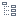

#  Отчет по регрессии

Визуализатор *Отчет по регрессии* для компонента [*Логистическая регрессия*](./../../processors/datamining/logistic-regression/README.md) отображает статистические параметры и результаты статистических тестов для анализа регрессионных моделей.

Данный визуализатор состоит из трех областей:

* [Информации о модели](#informatsiya-o-modeli).
* [Коэффициентов регрессии](#koeffitsienty-regressii).
* [Шагов построения](#shagi-postroeniya).

Подробно о том, как включить данный визуализатор, можно прочитать в [статье](./../README.md).

## Интерфейс

### Операции

#### Область Информация о модели

*  **Информация о модели** — отображение/скрытие информации о модели.

#### Область Коэффициенты регрессии

*  **Таблица** — переключение отображения [коэффициентов регрессии](#koeffitsienty-regressii) в вид *Таблица*.
*  **Дерево** — переключение отображения коэффициентов регрессии в вид *Дерево*.
*  **Нулевые значения** — отображение/скрытие нулевых значений.

#### Область Шаги построения

*  **Шаги построения** — отображение/скрытие [шагов построения](#shagi-postroeniya) модели.

### Области визуализатора

#### Информация о модели

Описание показателей модели представлено в таблице:

|Показатель|Описание|
|:------------------------|:-----------------------------------------------|
|  Константа | Информация о том содержит модель константу или нет |
|  Deviance нулевой модели| Показывает степень соответствия нулевой модели набору данных, на котором она обучается |
|  Deviance | Показывает степень соответствия модели набору данных, на котором она обучается |
|  [Псевдо R^2 МакФаддена](https://wiki.loginom.ru/articles/coefficient-mc-fadden.html) | Коэффициент детерминации МакФаддена определяется на основе логарифма функции правдоподобия и применяется для оценки степени соответствия модели регрессии реальным данным (изменяется от 0 до 1) |
|  [Псевдо R^2 МакФаддена (скорр.)](https://wiki.loginom.ru/articles/coefficient-mc-fadden.html) | Используется для сравнения моделей с различным числом факторов (изменяется от 0 до 1) |
|  Число степеней свободы ошибки | Разность между размером выборки и числом оцениваемых параметров модели |
|  [Число степеней свободы модели](https://wiki.loginom.ru/articles/degrees-of-freedom.html) | Число независимо варьируемых переменных модели |
|  [Хи-квадрат](https://wiki.loginom.ru/articles/chi-square-test.html) | Статистика отношения правдоподобия |
|  [Р-значение](https://wiki.loginom.ru/articles/p-value.html) | Оценка [значимости](https://wiki.loginom.ru/articles/significance-regr.html) модели. Чем меньше P-значение, тем меньше вероятность нулевой гипотезы о том, что нет статистически значимой связи между зависимой и независимыми переменными. Вычисляется по статистике отношения правдоподобия. |
|  [Критерий Акаике](https://wiki.loginom.ru/articles/aic.html) | Критерий используется для сравнения моделей с разным числом параметров, когда требуется выбрать наилучший набор объясняющих переменных |
|  [Критерий Акаике (скорр.)](https://wiki.loginom.ru/articles/aicc.html) | Модифицированный критерий Акаике, применяемый для [выборок](https://wiki.loginom.ru/articles/sample.html) малого размера, когда отношение числа содержащихся в ней примеров к числу параметров модели меньше 40 |
|  [Критерий Байеса](https://wiki.loginom.ru/articles/bic.html) | Критерий основан на использовании [функции правдоподобия](https://wiki.loginom.ru/articles/plausibility-function.html) и тесно связан с информационным критерием Акаике |
|  [Критерий Ханнана-Куинна](https://wiki.loginom.ru/articles/hq.html) | Критерий основан на использовании функции правдоподобия и является альтернативой критериям Акаике и Байеса |

#### Коэффициенты регрессии

Описание коэффициентов представлено в таблице:

|Коэффициент|Описание|
|:--------------------|:----------|
| Коэффициент | Оценки значений коэффициентов при независимых переменных |
| Стандартная ошибка | Стандартная ошибка оценки коэффициента |
| [Статистика Вальда](https://wiki.loginom.ru/articles/wald-test.html) | Статистика Вальда для оценки значимости переменной |
| Р-значение | Оценка значимости переменной. Чем меньше Значимость (Р-значение), тем меньше вероятность нулевой гипотезы о том, что коэффициент при независимой переменной равен 0. Вычисляется по z-статистике. |
| Отношение шансов | Отношение шансов наступления события к его не-наступлению для каждого увеличения переменной на одну единицу, при условии, что все другие переменные остаются постоянными |
| Нижняя граница ДИ | Нижняя граница [доверительного интервала](https://wiki.loginom.ru/articles/confidence-interval.html) отношения шансов |
| Верхняя граница ДИ | Верхняя граница доверительного интервала отношения шансов |

Коэффициенты регрессии могут быть представлены в виде  *Таблицы* (см. рисунок 1) или  *Дерева* (см. рисунок 2). 

#### Шаги построения

Область  *Шаги построения* имеет смысл включать только в том случае, если при настройке узла *Логистическая регрессия* в параметре *Отбор факторов и защита от переобучения* был выбран алгоритм, который подразумевает режим обработки фактов.

Область  *Шаги построения* состоит из следующих полей:

|Поле|Описание|
|:----------------|:----------------------------------------------------------------------------|
| Модель | Дерево, в котором отображается пошаговый процесс отбора факторов для построения финальной модели |
| Показатель | Значение выбранного показателя для текущей модели |
| Изменение поля |Отображает добавлен или удален был факт ("+" показывает, что факт был добавлен в модель, а "-" означает, что факт удален из модели) |
| Поля | Текущие поля модели |

Существует три вида моделей:

* **Нулевая модель** — начальная модель работы алгоритма.
* **Промежуточная модель** — модель, которую создал алгоритм в процессе обучения.
* **Финальная модель** — модель, которую алгоритм посчитал наилучшей, и дальнейшие действия не приведут к улучшению модели.

Доступные для выбора показатели:

* Deviance.
* Критерий Акаике.
* Критерий Акаике (скорр.).
* Критерий Байеса.
* Критерий Ханнана-Куинна.